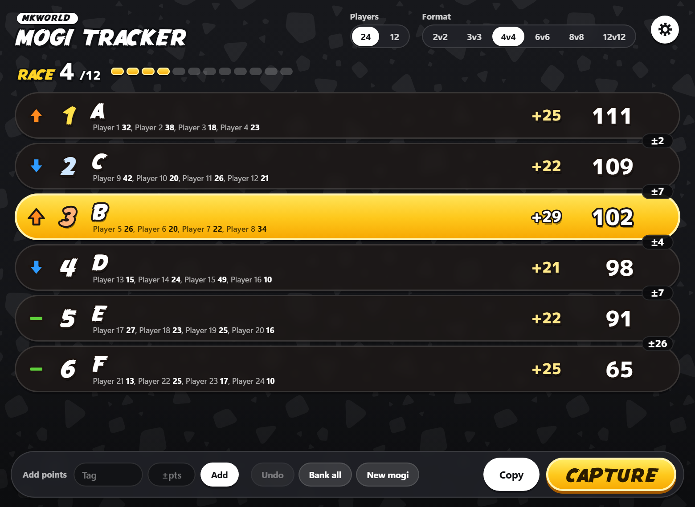
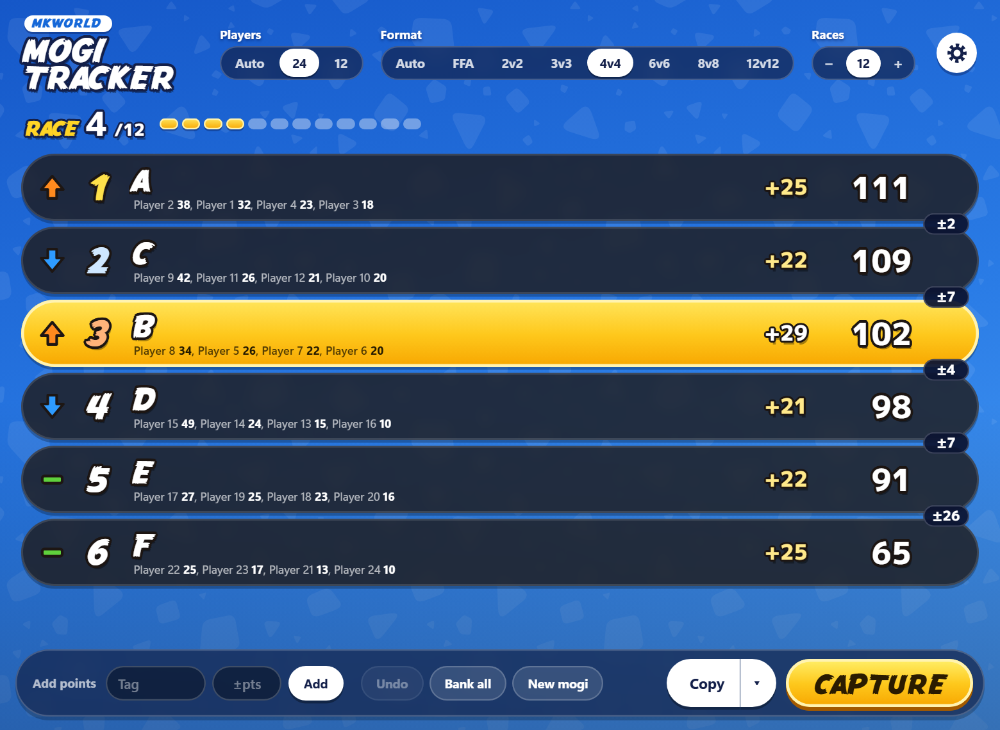
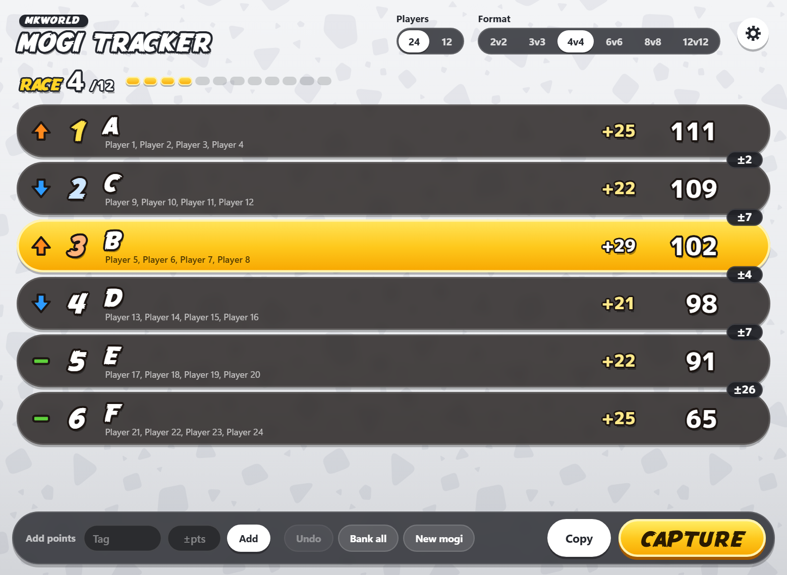
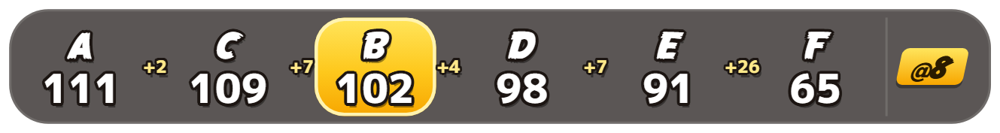
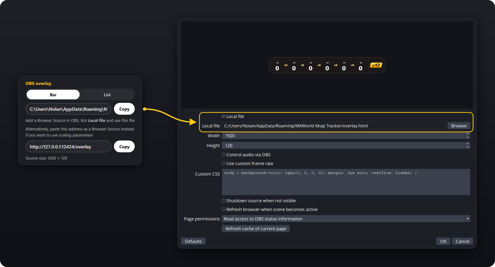
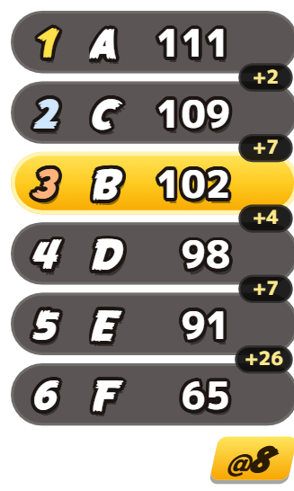

# MKWorld Mogi Tracker

Keeps the team scores of a Mario Kart World mogi, pretty much like every other Mario Kart score tracker from previous games.
Works for both 24p and 12p rooms! Also has an OBS overlay



<p>
  
  
</p>

## Download

Get `MKWorldMogiTracker.exe` from the [latest release](../../releases/latest)

Windows may show a "Windows protected your PC" notice the first time, because the file is not signed. Choose
**More info**, then **Run anyway**

## How to use

Mario Kart World HAS to be 16:9 fullscreen for this tracker to work at all!
1. Pick the room size (**24** or **12**), the team **format** and the number of **races** (12 by default) at the top
2. Open settings (the cog) and choose the capture source:
   - **Screen** takes a screenshot, and the game has to be fullscreen
   - **OBS Virtual Camera** reads your OBS (for capture cards) all you have to do is press *Start Virtual
     Camera* in OBS (make sure no stream overlay stuff is blocking the scoreboard)
3. When the results appear after a race, press **Capture** or the hotkey
   - **24p:** capture the *moment* the scoreboard starts moving. All the points get read while it moves
   - **12p:** capture once the scoreboard finishes adding points like usual
4. Also has a text output that you can share: `A 124 | B 73 | C 67 | @8`

> IMPORTANT: Make sure that you either set your OBS Virtual Camera source directly to your capture card, or that there's no stream overlay stuff covering the scoreboard!

### Auto-capture

Enable **Auto-capture** in settings and the app reads the scoreboard by itself after every race.
**AUTO** next to the Capture button means it's watching

- Give the game time to properly show results. If you start spamming A it usually still works, but if the
  results are gone before the tracker can see them, it tells you
- Auto-capture is likely to miss a race every now and then, so keep taking screenshots of the results
  (or make a clip in 24p)
- Also works in team mode if you really want it to
- Auto-capture very very slow. A 24p race can take over 25 seconds to process

### Adding points by hand

Type a tag and a number in **Add points** or click a team to fill in its tag. Negative numbers subtract from a team

**Undo** undoes literally whatever you did last: capture, add points, a format change etc.

### DCs

The tracker keeps track of every spot in the room, so it should be able to handle all the 12p DC quirks:

| Cause | Effect |
| --- | --- |
| A player left the room | Their points keep counting for their team |
| A bot raced in their place | The bot's points go to that player's team |
| The player rejoins with 0 | What they (and the bot) had stays with their team |
| 11p race | App offers to add the usual correction: +3 for 1st, +2 for 2nd, +1 for everyone else and the player who missed it |
| The mogi started with 11 | An *open spot* on the team that's missing a player gets the +1s until a sub joins |

A small note tells you when the tracker did one of these by itself. All of this does need you to have captured the races around the DC,
if one was missed and a total suddenly dropped, the app offers to bank the missing points instead. Just add points by hand if
you're unsure!

Individual points are also sown, handy to check totals after a lotts of DCs. Turn off
**Show individual points** in settings if you don't need them

### My tag

Ported from my [old 8DX table bot fork](https://github.com/nolanimations/8DX-World-Mogi-Table-Bot)

Enter your team's tag in the settings, and it will turn gold in the app and on the overlay. Your tag can be wrapped
in `**` in the copied text if you enable it in settings

### Custom tags

Hover a team and click the pencil to give it your own tag, like `AB` instead of `A` (up to 10 characters). It's purely visual,
it only changes the tag in the app, the OBS overlay and text output. Empty the box to go back. **New mogi** clears all custom tags

## OBS overlay



1. Copy the overlay **file** from settings (the second box)
2. In OBS, add a **Browser** source, tick **Local file** and pick that file. Set the size to **1920 × 120** for the
   bar (horizontal) or **240 × 1080** for the list (vertical)



I tested these for 1080p, but on a 1440p canvas 2560 × 160 or 320 × 1440 should work, on 4K double them, etc.

Using the overlay **address** instead works too, but then you have to open the tracker before OBS, or the overlay will stay empty until
you refresh the source. The only reason you'd use the address over the file is to fix the layout or the size: `…/overlay?layout=list&scale=1.25`



## Things to know

- `I` and `l`, and `O` and `0`, look identical in-game. The tracker treats them as the same letter when
  it matches tags
- Very small marks in a name, like an apostrophe, can be missed. This does not affect scores
- Settings, log and the last capture are stored in `%APPDATA%\MKWorld Mogi Tracker`
- The text recognition model is ran on CPU
- The tracker has auto-update

## Found a bug?

The tracker is in beta. Message **@Nolanimations** on Discord, and if it's about a capture:

- grab the screenshot of the race where it messed up: **Settings → Last capture → Open folder**. Ideally you have recorded footage (especially for autocapture) but a screenshot will do
- `tracker.log` from `%APPDATA%\MKWorld Mogi Tracker`

## Running from source

```
pip install -r requirements-dev.txt
python run.py
python -m pytest
```

The OCR model is not part of the source code, see [OCR model](#ocr-model)

`python run.py --browser` opens the app in a browser tab.

To build the exe (still needs the model):
```
.\build\build.ps1
```

## Credits

- Racers Delight font by @ImWhoreHay.
- [M PLUS 1p](https://fonts.google.com/specimen/M+PLUS+1p) by the M+ Project, under the SIL Open Font License
  (see `mogi_tracker/web/fonts/MPLUS1p-OFL.txt`)
- The text recognizer is built on [PaddleOCR](https://github.com/PaddlePaddle/PaddleOCR)'s PP-OCRv4 model, under the
  Apache License 2.0 (see `third_party/PaddleOCR-LICENSE.txt`)

## OCR model

The text recognizer that reads the results board is not in this repository. It is
built into the release, so you don't need to do anything to use the app.

If you want to run the tracker from source, or have another use for the model, you can ask for it on my
Discord: **@nolanimations**. It is shared on request only. Please do not redistribute it or use it in other
projects without asking first (see [LICENSE](LICENSE)). It is PaddleOCR's PP-OCRv4 Japanese text recognizer, fine-tuned
on synthetic text, no game files included. The training text was rendered in the game's typefaces so the
model learns to read the board, but no font data is contained in the model or the app.

## Licence

The code is under the [MIT licence](LICENSE). The two bundled fonts and the OCR model have their own terms, also listed there, 
and the part of the model that comes from PaddleOCR stays under the Apache License 2.0.

This is a fan-made tool. It is not affiliated with or endorsed by Nintendo. Mario Kart is a trademark of Nintendo.
No game files are included.
